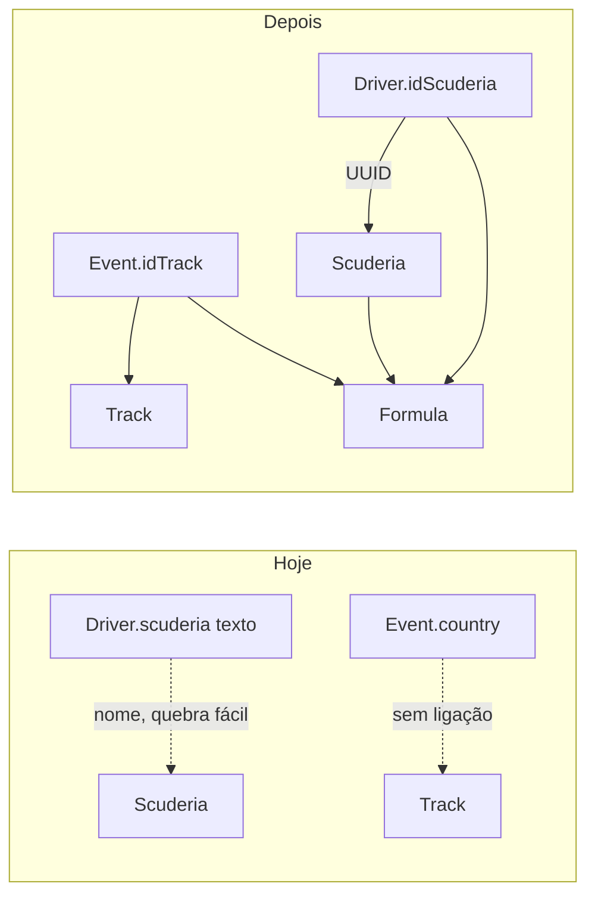

# Rotta: o que o app é, o que está quebrado, e o que mudar

Este documento é o planejamento de correção do **schema e da lógica de dados**. Serve para quem voltou ao projeto depois de muito tempo (foi feito ~2 anos atrás).

Não é um rewrite do app. É consertar a forma como os dados são gravados e buscados no CloudKit, para o ranking/calendário funcionarem e, depois, um sync (Wikipedia) conseguir **atualizar** pontos sem duplicar piloto.

---

## 1. O que é o Rotta, em uma frase

App iOS de Fórmula 2 / Fórmula 3 / F1 Academy: **calendário** das rodadas, **ranking** de pilotos e equipes, e **infos** (pilotos, scuderias, glossário, peças do carro).

Os dados **não** ficam só no iPhone. Ficam no **CloudKit público** (nuvem da Apple), para todo mundo ver o mesmo ranking. O código que lê/grava isso está em `Rotta/Database/`.

Container atual (branch `new-rotta`, conta Isadora): `iCloud.com.isadoraguerra.Rotta`.

---

## 2. Mapa mental: pastas que importam

| Pasta / arquivo | Função |
|---|---|
| `Rotta/Database/Models/` | Structs Swift (`DriverModel`, `ScuderiaModel`…). É o que a UI usa. |
| `Rotta/Database/Services/` | Fala com o CloudKit: `getAll`, `add`. Um service por tipo de dado. |
| `Rotta/Database/Database.swift` | Fachada: o resto do app chama `Database.shared.getAllDrivers()` em vez de cada service. |
| `Rotta/Database/CloudKitSeed.swift` | “Despejo inicial”: na primeira abertura, enche o CloudKit com F2 (pilotos, equipes, eventos…). |
| `Rotta/ViewModels/` | Telas pedem dados aqui (`RankingViewModel`, `CalendarViewModel`…). |
| `Rotta/Views/` | SwiftUI. `MainTabView` tem o seletor F2 / F3 / F1 Academy. |
| `Rotta/Database/Classes` e `Properties` | Restos de **CoreData**. A UI **não usa**. Pode ignorar por enquanto. |

Fluxo hoje:

```text
Tela (View) → ViewModel → Database.shared → XxxService → CloudKit público
                                                      ↑
App inicia → CloudKitSeed (se achar que está vazio)
```

---

## 3. As “tabelas” (record types) e o que cada tela precisa

Pense em cada tipo abaixo como uma tabela.

### Formula

Uma categoria: Fórmula 2, Fórmula 3, F1 Academy.

Campos: `id`, `name`, `color`.

Para que serve: filtrar ranking, calendário e infos. Sem isso, F2/F3/Academy misturam tudo.

### Scuderia (equipe)

Campos: `name`, `logo` (nome do asset, ex. `campos_logo`), `points` (temporada), `historicPoints`, `country`, `pole`, `victory`, `podium`, `details`, `idFormula`.

Telas: lista de equipes, ficha da equipe, ranking de construtores.

### Driver (piloto)

Campos: `name`, `country`, `number`, `points`, `scuderia` (hoje é o **nome** da equipe), `idFormula`, `photo`, `scuderiaLogo`, `height`, `birthDate`, `championship`, `details`.

Telas: lista, ficha, ranking de pilotos.

### Event (sessão de um fim de semana)

Não é “o GP da Itália” num record só. Cada **sessão** é um Event: Treino Livre, Classificação, Corrida Sprint, Corrida Principal.

Campos: `roundNumber` (rodada 1, 2, 3…), `country`, `name` da sessão, `date`, `startTime`, `endTime`, `idFormula`.

A UI agrupa os Events com o mesmo `roundNumber` e monta o card do calendário.

### Track, Car, Component, Rule, Glossary

Pistas, carro/peças, regras, glossário. Conteúdo mais estático. Glossário/regras **não** precisam do sync da Wikipedia.

---

## 4. Veredito

O **desenho** (essas entidades + CloudKit público) faz sentido.

A **implementação** tem buracos: IDs que não batem, piloto ligado à equipe pelo nome, não dá para atualizar um record, o seletor F3/Academy não filtra nada. Isso já quebra funções do app e impede o bot de ranking.

Abaixo: cada problema em três partes — o que é, por que importa, como resolver.

---

## 5. Problemas e soluções

### Problema 1 — Dois IDs, e “buscar por ID” não acha o piloto

**O que é**

No CloudKit, todo record tem um endereço oficial: `recordName` (tipo o número da casa).

O código também grava um campo `id` (um UUID em string). São **dois** identificadores.

- `FormulaService.add` faz o certo: cria o record **já** com `recordName = uuid` e copia o mesmo valor no campo `id`.
- `DriverService.add`, `ScuderiaService.add`, `EventService.add` etc. criam o record **sem** dizer o `recordName`. A Apple gera um ID aleatório (`ABCD-1234-…`). O UUID fica **só** no campo `id`.

Depois, `get(by:)` e `getDriverWithScuderiaIcon` pedem:

```swift
CKRecord.ID(recordName: id.uuidString)
```

Isso é “me dê a casa cujo **endereço** é este UUID”. No piloto, o endereço é o ID aleatório. O UUID está num papel **dentro** da casa. A busca volta vazia.

Analogia: você guarda o CPF da pessoa numa gaveta, mas a campainha da casa tem outro número. Quem toca a campainha com o CPF não entra.

**Por que importa**

Qualquer tela ou sync que precise “pegar este piloto / esta equipe pelo ID” falha, menos Formula.

**Como resolver**

Em **todo** `add`, igual à Formula:

```swift
let uuid = UUID().uuidString
let record = CKRecord(
    recordType: "Driver",
    recordID: CKRecord.ID(recordName: uuid)
)
record["id"] = uuid
```

Arquivos: todos os `*Service.swift` em `Rotta/Database/Services/`.

`get(by:)` continua usando `recordName`. Dados **já** gravados com ID aleatório não magicamente passam a ser achados: no primeiro run no container novo (o seu), o seed recria tudo do jeito certo. Se já tiver lixo no CloudKit, apagar no Dashboard ou `resetCloudKit()` e semear de novo.

---

### Problema 2 — Piloto e equipe não estão de verdade ligados

**O que é**

O seed grava no piloto:

- `scuderia = "Campos Racing"` (texto)

Mas o código tenta duas coisas que **não existem** nesses records:

1. `getByScuderia(scuderiaId:)` compara `driver.scuderia` com `scuderiaId.uuidString` (um UUID). `"Campos Racing" != "A1B2-…"`. Lista de pilotos da equipe = vazia.
2. `getDriverWithScuderiaIcon` lê o campo `idScuderia`. O `add` **nunca escreve** esse campo.

O logo da equipe ainda é copiado no piloto (`scuderiaLogo`). Se alguém mudar o logo na Scuderia, o piloto fica com o antigo.

**Por que importa**

Ficha da equipe (“estes são os dois pilotos”) e qualquer join piloto↔time quebram. O sync da Wikipedia precisa saber “este piloto é da Campos” de forma estável, não por string (`Mini` vs `Minì`, `Hitech` vs `Hitech TGR`).

**Como resolver**

1. No `DriverModel`, ter `idScuderia: UUID` (chave estrangeira).
2. No seed: criar as Scuderias **primeiro**, guardar o `id` de cada uma, e ao criar o piloto gravar `idScuderia` + (opcional) nome e logo só para a UI não fazer 2 fetches.
3. `getByScuderia`: predicate `idScuderia == %@` com o UUID.
4. `getDriverWithScuderiaIcon`: ler `idScuderia` e buscar a Scuderia com o `recordName` certo (problema 1).

Nome da equipe no piloto pode ficar como cache. A **fonte da verdade** é o UUID.

---

### Problema 3 — Só existe `add()`, não existe `update()`

**O que é**

Os services só **criam** record novo. Não há “este Nikola Tsolov já existe, só mude `points` para 167”.

Se o seed ou um script rodarem de novo, nasce um segundo “Nikola Tsolov”. O ranking mostra duplicata.

**Por que importa**

Sem `update`, o sync automático da Wikipedia **não pode existir**. Também não dá para corrigir um ponto errado sem apagar tudo.

**Como resolver**

Em `DriverService`, `ScuderiaService`, `EventService`:

1. Achar o record (pelo `recordName` / UUID, ou query `name` + `idFormula`).
2. Alterar só os campos vivos (`points`, `scuderia`/`idScuderia`, `number`, datas de evento).
3. `database.save(record)` ou `modifyRecords`.

Expor na fachada: `Database.shared.updateDriver(...)`.

O script futuro chama **update**. `add` só se a query não achar ninguém.

---

### Problema 4 — O seletor F2 / F3 / Academy não filtra nada

**O que é**

Em `MainTabView` você escolhe `"Fórmula 2"`, `"Fórmula 3"`, `"F1 Academy"`.

Isso **não** chega nos ViewModels. Ranking e Infos fazem `getAllDrivers()` / `getAllScuderias()` — tudo que estiver no CloudKit.

O seed só cria Formula com o nome `"Formula 2"` (sem acento). A UI usa `"Fórmula 2"`. Se um dia filtrar por string, **não acha**.

`DriverService.getByFormula` ainda: baixa **todos** os pilotos e tira os que não são da fórmula, **enquanto** percorre o array (`removeAll` no `for`). Frágil e lento. `ScuderiaService.getByFormula` já faz o certo: pergunta ao CloudKit `idFormula == uuid`.

**Por que importa**

Três categorias na UI, um único bolo de dados. F3/Academy são fake até isso existir.

**Como resolver**

1. Seed: nomes iguais à UI: `"Fórmula 2"`, `"Fórmula 3"`, `"F1 Academy"`.
2. `DriverService.getByFormula`: `NSPredicate(format: "idFormula == %@", idFormula.uuidString)` como a Scuderia.
3. Passar o `idFormula` selecionado para `RankingViewModel`, `CalendarViewModel`, listas de Infos. Não usar `getAll()` sem filtro.
4. No CloudKit Dashboard: marcar `idFormula` (e `name`, `idScuderia`) como **Queryable**. Sem isso o predicate falha em produção.

---

### Problema 5 — O seed acha que “já rodei” no iPhone, não na nuvem

**O que é**

`CloudKitSeed` guarda `hasSeededCloudKit` no **UserDefaults** (memória daquele aparelho).

CloudKit público é **compartilhado**. Cenários:

- iPhone A semeia. iPhone B instala, UserDefaults vazio, tenta semear de novo → risco de duplicar.
- Ou vê que “já existem Formulas” e pula o resto, mesmo com seed pela metade.

F3 e Academy estão **comentados** no seed. Só F2 entra, e ainda com dados de temporada velha.

**Por que importa**

Banco público inconsistente. Segundo device bagunça tudo. O cron não deve competir com o app escrevendo seed.

**Como resolver**

- Record no CloudKit, tipo `AppMeta` / `SeedState`, com `completed = true`. Qualquer device lê a nuvem.
- Fluxo normal do app: **só leitura**.
- Seed no app só se o public estiver vazio (primeiro run no **seu** container).
- Depois, quem atualiza pontos é o script, via `update`.

---

### Problema 6 — Pista e evento não se conhecem

**O que é**

`Event` tem `country` (“Itália”), não tem “este evento é em Monza”.

`Track` tem lista de fórmulas guardada como `Data` (bytes). CloudKit **não pesquisa** dentro desse blob. `getByFormula` de track não funciona. O seed ainda manda `idFormula: []`.

O card do calendário usa uma imagem fixa (`lusail-international-circuit`) para qualquer pista.

**Por que importa**

Não dá para mostrar o circuito certo, a distância, ou filtrar pistas por categoria.

**Como resolver (pode ser fase 2)**

- Campo `Event.idTrack` (UUID da Track), além de `country`.
- `Track.idFormula`: ou várias strings UUID consultáveis, ou tracks globais (Monza serve F2 e F3) e filtrar na memória — são poucas pistas.
- Seed preencher o vínculo. UI usar o track para imagem/nome.

---

### Problema 7 — “Pontos” mistura temporada e carreira

**O que é**

- Piloto: `points` é `Int16` (temporada).
- Equipe: `points` é `Double` (temporada) **e** `historicPoints` (`Int16`, carreira).
- A ficha da scuderia mostra `historicPoints` no rótulo **“Pontos”**. Ranking ordena por `points`. Usuário vê dois números com significados diferentes.

**Por que importa**

O sync da Wikipedia só traz pontos **da temporada**. Se gravar no campo errado, a ficha ou o ranking mente.

**Como resolver**

- Ranking e Wikipedia: só `Driver.points` e `Scuderia.points` (mesmo tipo, ex. `Int` ou `Double` nos dois).
- Ficha: deixar explícito “Pontos na temporada” vs “Pontos históricos” / poles / vitórias / pódios.
- Não usar `historicPoints` no pódio.

---

### Problema 8 — CoreData morto (não bloqueia o sync)

Existem `+CoreDataClass` / `+CoreDataProperties`. O app vive de CloudKit. Isso é resto de uma versão antiga. **Não mexer agora.** Apagar num cleanup depois do schema estável, para não confundir.

Outros detalhes menores: a variável `privateDatabase` na verdade é o banco **público**; erros viram `print` e a tela parece vazia; `Car` não tem nome.

---

## 6. O que **não** mudar agora

- Estrutura View → ViewModel → Database → Service.
- Event = uma sessão (4 records por rodada).
- Fotos/logos como nome de asset no catálogo.
- Glossário e regras manuais (Wikipedia não substitui).
- Script Wikipedia / GitHub Action: **só depois** de identidade + `update` + `idScuderia`.

---

## 7. Ordem de implementação (quando sair do planejamento)

1. **Identidade** — `CKRecord.ID(recordName: uuid)` em todo `add`; `get(by:)` usa isso.
2. **FK piloto–equipe** — gravar `idScuderia`; seed usa o UUID real; consertar `getByScuderia` e `getDriverWithScuderiaIcon`.
3. **`update`** — Driver, Scuderia, Event; nunca duplicar no sync.
4. **Filtro por fórmula** — predicate no Driver; ViewModels recebem a fórmula selecionada; nomes `"Fórmula 2"` / `"Fórmula 3"` / `"F1 Academy"`.
5. **Seed** — flag no CloudKit, não UserDefaults; app só lê se já houver dados.

Depois, se fizer sentido: `Event.idTrack`, tipos de pontos alinhados, limpar CoreData.

No Dashboard, índices **Queryable**: `name`, `idFormula`, `idScuderia`.

---

## 8. Relacionamentos hoje vs depois


